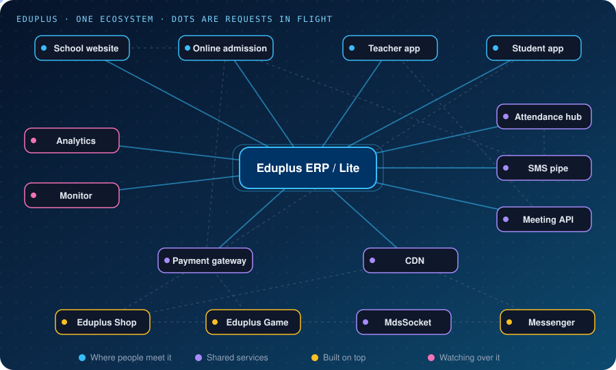
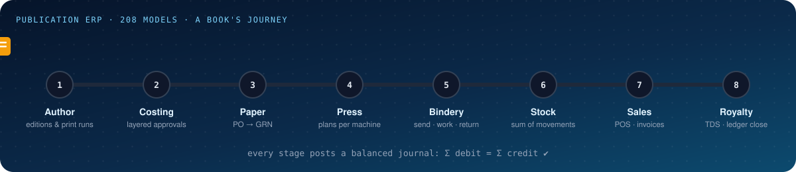
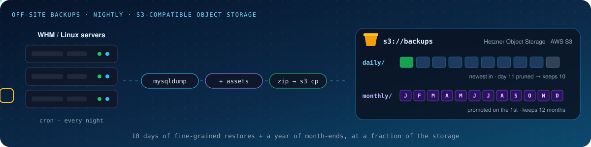

 

  

## 👨‍💻 About me

I'm the **CTO & Lead Software Engineer at [Light Technologies](https://lighttechnologiesbd.com)**, a BASIS-member software company in Dhaka. I lead the technical vision and every product we ship, including **Eduplus**, a school platform used by schools, colleges and madrasas across Bangladesh.

I work across the whole stack. I'll model a double-entry ledger in the morning, write a WebSocket server in Go after lunch, and harden the Linux server it deploys to before I go home. I'm also a **Top Rated freelancer on Upwork**, with 37+ projects and a 100% job success rate.

| | |
|:--|:--|
| 🏢 **Now** | CTO & Lead Software Engineer · Light Technologies |
| 🎓 **Education** | B.Sc. in Computer Science & Engineering · Bangladesh University (2019–2023) |
| 🌍 **Location** | Dhaka, Bangladesh (GMT+6) · replies within 2–4 hours |
| 🔓 **Open source** | Contributor to [HestiaCP](https://github.com/hestiacp/hestiacp) · 12 packages on Packagist |
| 💬 **Ask me about** | Laravel architecture, multi-tenancy, Go tooling, Linux servers, security |

## 🧩 What I'm building: the Eduplus ecosystem

Eduplus isn't one app. It's an ecosystem of products and shared services I designed to fit together: an ERP at the core, apps and websites where people meet it, shared services for payments, SMS, meetings, storage and real-time messaging, and dashboards watching over all of it.

## 📚 A book's journey through my ERP

I built a **208-model ERP for a book publisher**. It follows a book from the author's manuscript, through costing, paper purchasing, the printing press, the bindery, the warehouse and sales, to the author's royalty, posting a balanced double-entry journal at every step. Payroll, provident fund, fixed assets and rentals run on it too.

## ☁️ Cloud & infrastructure

I've run production on **AWS**, **Hetzner**, **Linode**, **DigitalOcean** and **Google Cloud**, plus a fleet of WHM/cPanel servers for school and client sites.

  
  
  
  
   
  
  
  
  
  

**Off-site backups I built:** every night, Bash jobs on each WHM server dump every MySQL database and collect the media assets (plus any file a site marks with `.backupme`), zip the day, and push it to S3-compatible object storage (Hetzner Object Storage, AWS S3) with the AWS CLI. A grandfather-father-son rotation keeps **10 daily** backups and promotes the last one of each month to **12 monthly** backups.

## 🛠️ Tech stack

   
   
  

**Also:** Pest · WebSockets · WebRTC · Web Push · SSLCommerz · WHM/cPanel · HestiaCP · Hetzner · Linode · DigitalOcean · Let's Encrypt · Bash automation · penetration testing · hardening · LLM APIs & RAG

## 💼 Experience

| Role | Where | When |
|:--|:--|:--:|
| **CTO & Lead Software Engineer**: Eduplus platform, ERPs, shared services, servers and security | [Light Technologies](https://lighttechnologiesbd.com) | 2021 – now |
| **Top Rated Freelancer**: backend systems, APIs, server administration · 37+ projects, 100% JSS | [Upwork](https://www.upwork.com/freelancers/~017a04691e484ba543) | 2019 – now |
| **System Administrator**: AWS (EC2, RDS, load balancers, S3, Route 53), Hetzner, Linode, DigitalOcean, Google Cloud and WHM/cPanel, including WithImpact.com · off-site S3 backups | Light Technologies & clients | 2020 – now |

## 🚀 Featured work

<b>🏗️ Systems I've architected</b>

 

| System | Highlights |
|:--|:--|
| **Eduplus ERP & Lite** | Admissions, exams, results, fees, HR and SMS · multi-tenant · Laravel 13 + Pest |
| **Eduplus Attendance Hub** | One normalized pipeline for 100+ schools across many device vendors · Go workers |
| **Eduplus CDN** | Self-hosted, S3-style storage · Laravel control plane, Go data plane on NVMe |
| **Publication ERP** | 208 models · press, bindery, warehouse, sales, royalties with TDS, payroll, general ledger |
| **Light Tech Monitor** | File integrity, malware detections, health, disk, logs, backups and traffic for every hosted domain |
| **Eduplus Messenger** | Chat, groups, read receipts, presence, web push, WebRTC calls |
| **Eduplus Teacher & Student apps** | Flutter apps for attendance, routines, marks and online classes |
| **TravelPlus · MediFind BD · Rahma Organics** | Hajj/Umrah agency SaaS · healthcare directory · e-commerce |

<b>📦 Packages on Packagist</b>

 

| Package | Description |
|:--|:--|
| [`mojahed/aiapi`](https://packagist.org/packages/mojahed/aiapi) | One Laravel interface for OpenAI, Claude, Gemini, Ollama, Groq, DeepSeek and more |
| [`mojahed/spa`](https://packagist.org/packages/mojahed/spa) | SPA feel for Laravel with Alpine.js + Axios. No build step |
| [`mojahed/webpush`](https://packagist.org/packages/mojahed/webpush) | Web Push (VAPID + RFC 8291) with zero dependencies |
| [`mojahed/jilapi`](https://packagist.org/packages/mojahed/jilapi) | AES-256-GCM / Argon2id encryption for strings and files |
| [`mojahed/converts`](https://packagist.org/packages/mojahed/converts) | Bangla ↔ English digits, numbers, dates, units and hashes |
| [`mojahed/mparser`](https://packagist.org/packages/mojahed/mparser) | Parse complex strings with custom tokens and expressions |
| [`mojahed/eduplusqr`](https://packagist.org/packages/mojahed/eduplusqr) · [`mojahed/eduplusbarcode`](https://packagist.org/packages/mojahed/eduplusbarcode) | Fast QR and barcode generation with a Go backend |
| [`mojahed/only-eye`](https://packagist.org/packages/mojahed/only-eye) | Hide emails and markup from scrapers |
| [`eduplus/qr`](https://packagist.org/packages/eduplus/qr) · [`eduplus/archive`](https://packagist.org/packages/eduplus/archive) · [`eduplus/attendance`](https://packagist.org/packages/eduplus/attendance) | Eduplus SDKs for Laravel and PHP |

<b>⚙️ Mojahed Dev Suite: single-binary Go tools</b>

 

`MdsSocket` WebSocket server · `EduplusQR` its own QR encoder, Bangla QR · `jilapi` file encryption · `MdsOstrich` sysadmin CLI · `MdsNetwork` browser SSH relay · `mdstunnel` dev tunnels · `MdsCurl` concurrent fetcher · `Tinkercode` Laravel runner · `mdsuitest` JSON-driven UI tests · `mdtorag` Markdown → RAG index · `MdsImage` · `Gitwatch` · `MdsType`

Plus browser extensions: **Md's Filler** (realistic Bangladeshi test data) and **Eduplus Mark Input**.

## 🧭 How I build

| | Principle | In practice |
|:--:|:--|:--|
| 📦 | **No build step unless it earns its place** | Blade + Alpine.js + Bootstrap, often no npm at all |
| 🧱 | **One binary, zero dependencies** | Infrastructure tools are single static Go binaries |
| 💾 | **Write atomically** | `.tmp` then `rename()`, so a crash never leaves half a file |
| 🇧🇩 | **Local first** | Bangladeshi boards, Bangla digits, lakh/crore, Taka, Bangla QR |
| 🔐 | **Privacy is a design decision** | Call audio and video are never stored, only the metadata |
| 👁️ | **If it runs, watch it** | Integrity baselines, malware scans and alerts on every server |

## 🦆 Need a breather? Play Duck Drift

**Deadline close? Prod on fire? Take 3 minutes.** Duck Drift is a small browser game I made for developers under pressure. You steer a rubber duck with your breath, let your worries float away, and watch the night turn into sunrise.

  
   
  👆 Click the game to play in your browser. No install, no sign-up, works on phones.

| 🎮 How to play | |
|:--|:--|
| **Hold** space, the mouse or your finger | Breathe **in** (4 s). The duck rises |
| **Release** | Breathe **out** slowly (6 s). The duck drifts down |
| **Follow the glowing path** | Stay in sync to build your calm combo |
| **Fly through the dark clouds** | *"prod is down"*, *"CI is red"*… each one bursts into stars with a kinder thought |
| **Catch fireflies** | Every one plays a note, and none of them clash |

<b>🧠 Why it works</b> (and why there's no way to lose)

 

- **Slow breathing:** the path paces you to about **6 breaths a minute with a longer exhale**. Breathing near that rate is linked to higher heart-rate variability, a marker of a calmer nervous system (Lehrer & Gevirtz, 2014).
- **Longer exhales:** in a 2023 study, a few minutes a day of exhale-focused breathing improved mood more than mindfulness meditation did (Balban et al., *Cell Reports Medicine*).
- **Naming worries:** labelling a stressful thought and watching it pass is a core move in Acceptance & Commitment Therapy. That's what the clouds are for.
- **No fail state:** no lives, no game over, every note in harmony. You get novelty without threat.

You rate your tension before and after. At the end you get a title like *Senior Calm Engineer* and can **save a postcard PNG** to share. Scores live only in your own browser. Nothing is uploaded and nobody else sees them.

*It's a toy, not therapy. If stress is heavy and constant, please talk to someone.* 💙

## 🤝 Let's work together

**Have a system that needs building, fixing or scaling?** 
I usually reply within 2–4 hours during business hours.

 

💡 I enjoy turning complex real-world problems into simple, elegant software.

